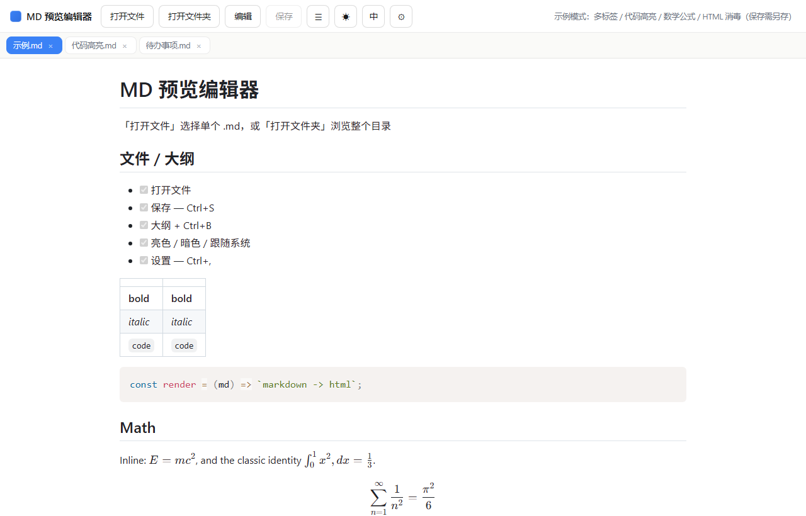
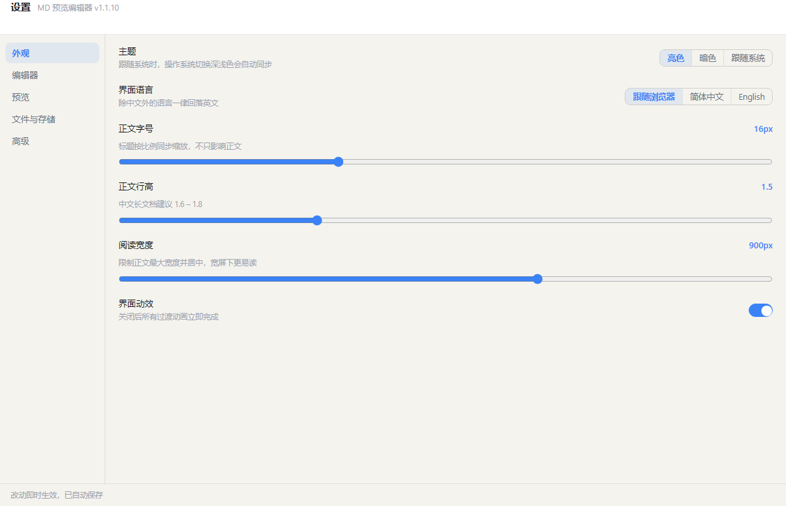

# md-tiny · 轻量 Markdown 工具集 v1.0

---

## 一、这个项目是什么

两个**互相独立**的轻量 Markdown 方案，共用同一套编辑器内核。目标很朴素：

> **我只想快速看 / 改一个 `.md` 文件，不想为此装一个几百 MB 的桌面应用。**

- 纯本地运行：**不联网、不上传、不收集任何数据**
- 零构建链：内核是原生 JavaScript，改完即用，不需要打包器、不需要 `npm install`
- 双形态对等：扩展与 Windows 版的功能逐项一致，代码单源维护（内核**逐字节镜像**）

|                   | ① 浏览器扩展                       | ② Windows 本地启动器    |
| ----------------- | ----------------------------- | ------------------ |
| 发布包体积             | **477 KB**                    | **528 KB**         |
| 运行形态              | Chrome / Edge 扩展（Manifest V3） | 本地 Node 服务 + 浏览器页面 |
| 启动方式              | 工具栏图标 / `Ctrl+Shift+M`        | **双击 `.md` 文件**    |
| 是否需要安装            | 开发者模式加载，无需管理员                 | 写 `HKCU` 注册表，无需管理员 |
| **双击 `.md` 直接打开** | ❌ 平台不支持                       | ✅                  |

体积构成里约 **59%** 是按需加载的数学公式字体，**首屏实际加载量约 340 KB** —— 正文不出现公式时，KaTeX 一个字节都不会请求。

**当前版本：v1.0**（两项交付物统一版本号）

---

## 二、这个版本有什么

按「改得像样、调得动、不丢字节」三条线展开。

### 2.1 编辑体验

|    | 能力                                                                                                                       |
| -- | ------------------------------------------------------------------------------------------------------------------------ |
| ✍️ | **所见即所得编辑** —— 点「编辑」后 `#preview` 直接变成可编辑容器，字体 / 间距 / 代码底色全部沿用预览样式，不再跳到一个朴素的源码框；**没改动过的块用原文切片回写**，只有你动过的那一块才重新生成 Markdown |
| 🧷 | **源码字节零改动** —— 打开时记下换行风格（CRLF / LF）与 BOM，落盘按记录还原；内容没变时**逐字节回放**，不再出现「编辑一次，整份文件行尾全变 LF」                                   |
| 🔀 | **「源码」按钮** —— 编辑态下随时在「所见即所得 ↔ 源码」之间切换，两种方式共用同一份内容                                                                        |

### 2.2 设置面板

可调项不止主题和语言 —— 观感与行为参数全部收拢成一份可配置的定义表，并给出界面。想调正文字号、想关掉某个按钮，都不必再动源码。

|     | 能力                                                                                                                          |
| --- | --------------------------------------------------------------------------------------------------------------------------- |
| ⚙️  | **设置面板** —— 扩展端独立选项页（右键扩展图标 →「选项」）；Windows 端编辑器内弹层                                                                          |
| 🎛️ | **16 项可调参数** —— 主题 / 界面语言 / 正文字号 / 行高 / 阅读宽度 / 界面动效 / 源码字号 / 缩进宽度 / 拼写检查 / 复制按钮 / 公式渲染 / 图片放大 / 自动刷新 / 关闭确认 / 离开提醒 / 侧栏自动展开 |
| 🧩  | **一处定义，处处生效** —— `SCHEMA` 是唯一事实来源，界面由定义表现场生成，加一个设置只改一处                                                                      |
| 🔁  | **自动刷新已打开文件**（默认关闭）—— 磁盘被外部改动时自动重载；当前标签有未保存内容时**只提示、不覆盖**                                                                   |
| 📤  | **导出 / 导入设置** —— `MDTN-SET/1` 明文（带指纹校验）或 `MDTN-E1` 口令封装                                                                     |
| ⌨️  | **`Ctrl+,` 打开设置**                                                                                                           |

### 2.3 观感与规范

|    | 能力                                                                                                             |
| -- | -------------------------------------------------------------------------------------------------------------- |
| 🎨 | **深色 / 亮色主题** —— 亮色 / 暗色 / 跟随系统三态，正文、代码高亮、滚动条同步换肤                                                              |
| 📑 | **大纲侧栏** —— 「文件 / 大纲」双分栏，标题随正文滚动高亮，点击跳转                                                                        |
| 📋 | **代码块一键复制**                                                                                                    |
| 🔍 | **图片点击放大** —— 灯箱查看，`Esc` 退出                                                                                    |
| ∑  | **数学公式** —— KaTeX 按需加载，支持 `$…$`、`$$…$$`、`\(…\)`、`\[…\]` 与环境式写法                                                 |
| 🌐 | **中英文界面** —— 按浏览器语言自动识别，可手动切换（其他语言回落英文）                                                                        |
| ⌨️ | **快捷键扩展** —— `Ctrl+B` 侧栏、`Ctrl+Shift+L` 主题                                                                     |
| 🔏 | **自有签名格式** —— `MDTN-SIG/1`，逐文件 SHA256 + 内容指纹随包分发，可离线复核                                                         |
| 🤖 | **发布自动化** —— 打 tag 自动构建、校验签名、生成校验和并发布                                                                          |
| 🧹 | **清单加载零警告** —— 移除 `file_handlers`（Chrome 只授权给 packaged app，而它本身又是 ChromeOS 独占能力）：功能拿不到、警告却一直挂，扩展卡片上的「警告」按钮现在消失 |

### 2.4 已知限制

- **混合行尾**的文件（同一份文档里 CRLF 与 LF 混杂）在编辑保存后**按多数派统一**；只有「一个字符都没改」时才逐字节回放
- 富文本层只覆盖 marked 会产出的那套标签。文档里手写的**原始 HTML 段与链接定义不参与编辑**（整块原样带走，界面里会标灰）
- 数学公式在编辑态以 `$…$` 源码呈现（与 Typora 同样的取舍），退出编辑立刻变回渲染结果
- 编辑态里输入 `2 * 3 * 4` 这类**成对符号**，保存后会被 Markdown 当成斜体语法 —— 行内语法靠 DOM 结构表达，这是该实现方式的固有代价
- Windows 版的保存分两条路：**双击关联 / 侧栏文件树**打开的文档走本地服务原子写（带 mtime 冲突检测、BOM 记账）；用**「打开」按钮**选中的文档走浏览器文件句柄直接写回（网页拿不到本地绝对路径，这是唯一途径），不经过服务端
- 可编辑的类型是 `.md` / `.markdown` / `.mdown` / `.txt`；其它扩展名既不出现在侧栏，双击也不关联

---

## 三、怎么用

### ① 浏览器扩展

1. 解压 `md-tiny-extension-v1.0.zip`
2. 打开 `chrome://extensions`（Edge 用 `edge://extensions`），开启右上角「开发者模式」
3. 点「加载已解压的扩展程序」，选择解压出的 `md-tiny-extension` 目录
4. 点工具栏图标，或按 `Ctrl+Shift+M`
5. 想调参数：右键扩展图标 →「选项」，或按 `Ctrl+,`

> 浏览器里随手改 Markdown 用这个。**它不能双击打开 `.md`**

### ② Windows 本地启动器

前提：已安装 [Node.js](https://nodejs.org/)（在系统 PATH 中）。**无需 `npm install`，零第三方依赖。**

1. 解压 `md-tiny-win-v1.0.zip` 到**固定位置**（建议 `%LOCALAPPDATA%\Programs\md-tiny-win`，别放 `Downloads`）
2. 双击 `安装.cmd`，或先看它会做什么：`node install.js --dry-run`
3. 右键任意 `.md` 文件 →「打开方式」→「选择其他应用」→ 选中本编辑器 → 勾选「始终使用」

> 第 3 步无法静默完成：Windows 的默认程序关联有哈希保护，必须用户手动确认一次。

卸载：双击 `卸载.cmd`，或 `node uninstall.js --purge`（只删自己的注册表值，不影响其它程序的关联）。

> ⚠ **关联全局只有一份。** 文件关联属于**当前用户**，同一时刻只有一份生效 ——  
> 在另一个目录再跑一次安装，就会把原来那份顶掉（`node install.js` 会把新旧目录都打印出来）。  
> 两条副本还会共用同一个端口（各带各的 Token），这正是「服务起来了、页面却是空的」的成因。  
> 所以：同一台机器上**只保留一份**已安装副本，并且**不要把 `dist/` 这类会被重建的构建产物目录  
> 当作安装位置** —— 目录一旦被换掉，双击 `.md` 会变成「完全没反应」，日志里也不会有任何线索。

### 快捷键

| 组合键            | 作用                   |
| -------------- | -------------------- |
| `Ctrl+S`       | 保存并写回原文件             |
| `Ctrl+W`       | 关闭当前标签               |
| `Ctrl+B`       | 显示 / 隐藏侧栏            |
| `Ctrl+Shift+L` | 切换主题（亮色 / 暗色 / 跟随系统） |
| `Ctrl+Shift+M` | 唤起编辑器（仅扩展）           |
| `Ctrl+,`       | 打开设置面板               |
| `Esc`          | 关闭图片灯箱 / 关闭设置面板      |

### 常见操作

| 想做的事 | 怎么做 |
| --- | --- |
| 改完看效果 | 打开即预览；点「编辑」直接改，排版不变 |
| 想改 Markdown 源码 | 编辑态点「源码」按钮，改完随时切回 |
| 关掉某个按钮 / 调字号 | `Ctrl+,` → 设置面板，改完即时生效并自动保存 |
| 换设备保留设置 | 设置面板 →「导出设置」，新设备「导入设置」 |
| 换主题 | `Ctrl+Shift+L` 三态轮换 |
| 找不到文件树 | `Ctrl+B` 唤出侧栏 |

每个交付目录另有自己的说明：[`extension/README.md`](extension/README.md) · [`win/README.md`](win/README.md)。
